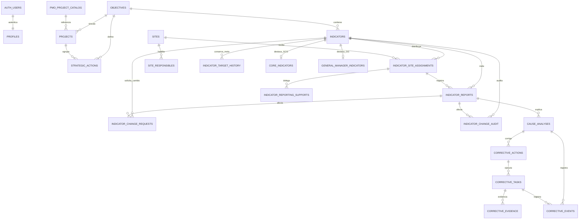

# Modelo de datos — Gestión Estratégica / BIONEXORA

Modelo vigente en Supabase, validado el 4 de noviembre de 2026. Todas las tablas de negocio pertenecen al esquema `public`; la autenticación se administra en `auth.users` de Supabase.

## 1. Identidad, roles y directorio

| Tabla | Clave | Propósito y campos principales |
|---|---|---|
| `auth.users` | `id` (Supabase) | Cuenta autenticada mediante Microsoft. Es administrada por Supabase Auth. |
| `profiles` | `id` → `auth.users.id` | Perfil de sesión: `email`, `role`, fechas de creación y actualización. |
| `role_assignments` | `email` | Rol habilitado para ingresar: `gcg`, `gerente_responsable`, `gerente_general`, `super_admin` o `usuario`. |
| `organization_people` | `id` | Directorio organizacional: `full_name`, `email`, `role`, `active`, `job_title`, `management`, `submanagement`, `is_management_lead`. Es la fuente de responsables. |
| `microsoft_directory` | `email` | Directorio sincronizado de Microsoft: `microsoft_id`, `full_name`, `synced_at`. |
| `dashboard_messages` | `recipient_email` | Mensaje personalizado del monitor: `message`, `updated_by`, fechas. |

## 2. Planeamiento estratégico

| Tabla | Clave | Relación | Campos principales |
|---|---|---|---|
| `objectives` | `id` | Padre de indicadores, proyectos y acciones | `code`, `name`, `description`, `focus`, `responsible_management`, `owner_email`, `validity_start_year`, `validity_end_year`, `progress`, `status`, `target_date`, `stakeholders`, `created_by`. |
| `indicators` | `id` | `objective_id` → `objectives` | `code`, `name`, `formula`, `target`, `unit`, `comparator`, `frequency`, `review_frequency`, `objective_weight`, `owner_email`, `reporter_email`, `status`, `approval_status`. La `target` puede quedar vacía como meta pendiente de definición; ese indicador no se aprueba ni mide hasta completar su meta. Un objetivo puede tener varios indicadores; sus ponderaciones se redistribuyen en partes iguales. |
| `projects` | `id` | `objective_id` → `objectives`; `catalog_id` → `pmo_project_catalog` | `name`, `status`, `progress`, `owner_email`, `source`, fechas. |
| `strategic_actions` | `id` | `objective_id` → `objectives`; `project_id` → `projects` | `name`, `description`, `status`, `due_date`, `owner_email`, `completed_at`. |
| `pmo_project_catalog` | `id` (UUID) | Catálogo externo de proyectos PMO | `code`, `name`, `description`, `responsible_name`, `status`, `progress`, `end_date`, `project_url`, `source`. |
| `entity_code_counters` | `entity_type`, `code_year` | Soporte para códigos correlativos | `last_number`. |

## 3. Medición de indicadores por sede

| Tabla | Clave | Relación | Campos principales |
|---|---|---|---|
| `sites` | `id` | Padre de asignaciones | `name`, `active`, `created_at`. Contiene Biomont, Kuntur Pharma y Biomont Ecuador. |
| `site_responsibles` | `site_id`, `email` | `site_id` → `sites` | Responsables autorizados por sede: `active`, fechas. |
| `indicator_site_assignments` | `id` | `indicator_id` → `indicators`; `site_id` → `sites` | Responsable y ponderación por sede: `responsible_email`, `weight`, `active`. Una sede solo se asigna una vez por indicador. |
| `indicator_reporting_supports` | `id` | `site_assignment_id` → `indicator_site_assignments` | Delegados de registro: `support_email`, `active`, `created_by`. |
| `indicator_reports` | `id` | `indicator_id` → `indicators`; `site_assignment_id` → `indicator_site_assignments` | Medición mensual: `period`, `result`, `status`, `registered_date`, `observations`, `measurement_target`, `measurement_comparator`, `created_by`. Conserva la meta vigente al momento de medir. |
| `indicator_target_history` | `id` | `indicator_id` → `indicators` | Historial de metas: `target`, `comparator`, `effective_date`, `changed_by`. |

## 4. Gobierno, selección y auditoría de indicadores

| Tabla | Clave | Relación | Campos principales |
|---|---|---|---|
| `core_indicators` | `indicator_id` | `indicator_id` → `indicators` | Indicadores priorizados por GCG: `position`, `created_at`. |
| `general_manager_indicators` | `indicator_id` | `indicator_id` → `indicators` | Indicadores visibles para Gerencia General: `position`, `created_at`. |
| `indicator_change_requests` | `id` | `indicator_id` → `indicators`; `report_id` → `indicator_reports` | Solicitudes: `kind`, `proposed`, `previous`, `reason`, `status`, `requested_by`, `reviewed_by`, `review_comment`. |
| `indicator_change_audit` | `id` | `indicator_id` → `indicators`; `report_id` → `indicator_reports` | Bitácora inmutable: `kind`, `previous`, `current`, `reason`, `changed_by`, `changed_email`. |

## 5. Desviaciones y acciones correctivas

| Tabla | Clave | Relación | Campos principales |
|---|---|---|---|
| `cause_analyses` | `id` | `report_id` y `followup_report_id` → `indicator_reports` | Análisis de causa: `code`, `cause`, `deviation_description`, `complementary_data`, `five_whys`, `status`, `approved_at`, responsables de decisión. |
| `corrective_actions` | `id` | `analysis_id` → `cause_analyses` | Acción correctiva: `name`, `description`, `responsible`, `due_date`. |
| `corrective_tasks` | `id` | `action_id` → `corrective_actions` | Tareas de ejecución: `name`, `description`, `progress`, `review_status`, `review_note`, notificación y revisión. |
| `corrective_evidence` | `id` | `task_id` → `corrective_tasks` | Evidencias: `storage_path`, `file_name`, `file_size`, `uploaded_by`. |
| `corrective_events` | `id` | `analysis_id` → `cause_analyses`; `task_id` → `corrective_tasks` | Trazabilidad de cambios: `event`, `note`, `snapshot`, `actor`, `created_at`. |
| `analysis_code_counters` | `code_year` | Soporte para códigos correlativos de análisis | `last_number`. |

## 6. Reglas operativas clave

1. Un objetivo puede tener múltiples indicadores. La ponderación de todos sus indicadores se ajusta automáticamente para sumar 100 %.
2. El avance de un objetivo se calcula con las mediciones del año vigente. Un indicador sin medición aporta 0 %.
3. Un indicador puede asignarse a varias sedes. Las mediciones se diferencian por asignación de sede y periodo.
4. La meta y el comparador se guardan en cada medición para preservar el histórico aunque la meta cambie después.
5. Las solicitudes de cambio y la bitácora de auditoría conservan el antes/después en campos JSON.
6. Las políticas RLS de Supabase protegen las tablas. GCG administra objetivos, indicadores y configuración; los responsables reportan solo sus asignaciones o delegaciones.

## 7. Funciones de negocio relevantes

| Función | Uso |
|---|---|
| `bulk_import_strategic_plan(jsonb)` | Crea objetivos e indicadores de una carga masiva validada. |
| `register_site_indicator_measurement(...)` | Registra una medición para una sede y verifica permisos. |
| `register_indicator_measurement(...)` | Registra una medición sin sede específica, cuando aplica. |
| `rebalance_objective_indicator_weights()` | Redistribuye ponderaciones después de agregar o eliminar indicadores. |
| `delete_objective(...)` | Elimina un objetivo y su información vinculada con las reglas correspondientes. |
| `is_gcg()` / `is_super_admin()` | Determinan privilegios de gobierno. |
